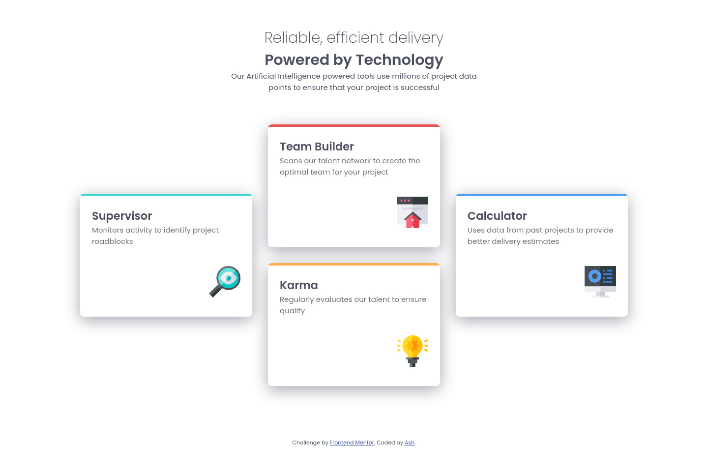

# Frontend Mentor - Four card feature section solution

This is a solution to the [Four card feature section challenge on Frontend Mentor](https://www.frontendmentor.io/challenges/four-card-feature-section-weK1eFYK). Frontend Mentor challenges help you improve your coding skills by building realistic projects. 

## Table of contents

- [Overview](#overview)
  - [The challenge](#the-challenge)
  - [Screenshot](#screenshot)
  - [Links](#links)
- [My process](#my-process)
  - [Built with](#built-with)
  - [What I learned](#what-i-learned)
  - [Continued development](#continued-development)
  - [Useful resources](#useful-resources)
- [Author](#author)
- [Acknowledgments](#acknowledgments)

## Overview

### The challenge

Users should be able to:

- View the optimal layout for the site depending on their device's screen size

### Screenshot

### Links

- Solution URL: [GitHub](https://github.com/BoundoTheWitch/four-card-feature-section)
- Live Site URL: [Netlify](https://superb-conkies-902da3.netlify.app/)

## My process

### Built with

- Semantic HTML5 markup
- CSS custom properties
- Flexbox
- CSS Grid
- Mobile-first workflow

### What I learned

I learned how to extensively use flexbox, including what not to do and the importance of not overdoing it (adding one too many properties)

### Continued development

I wanted to try and use grids to make the layout of the boxes for the desktop portion of the site. But due to time constraints I settled with making it in flexbox instead. I did learn how to use CSS grids more extensively so in the future I plan to implement it in some of my projects.

### Useful resources

- [MDN](https://developer.mozilla.org/en-US/) - This was helpful when I needed to reference how certain properties worked in CSS.
- [Box Shadow Generator](https://cssgenerator.org/box-shadow-css-generator.html) - Helpful for seeing how the shadows are rendered without having to type all of the values out.

## Author

- Website - [Ash Chapman](https://boundothewitch.github.io)
- Frontend Mentor - [@BoundoTheWitch](https://www.frontendmentor.io/profile/boundothewitch)
